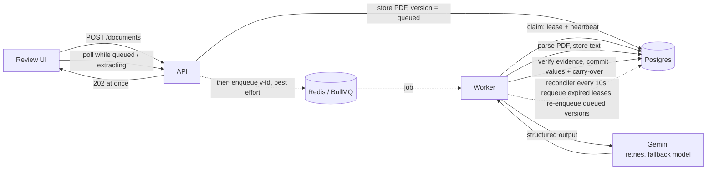
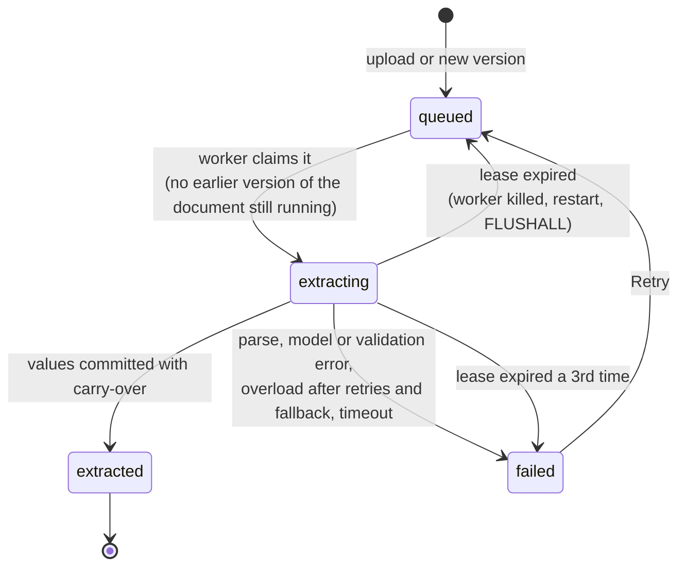
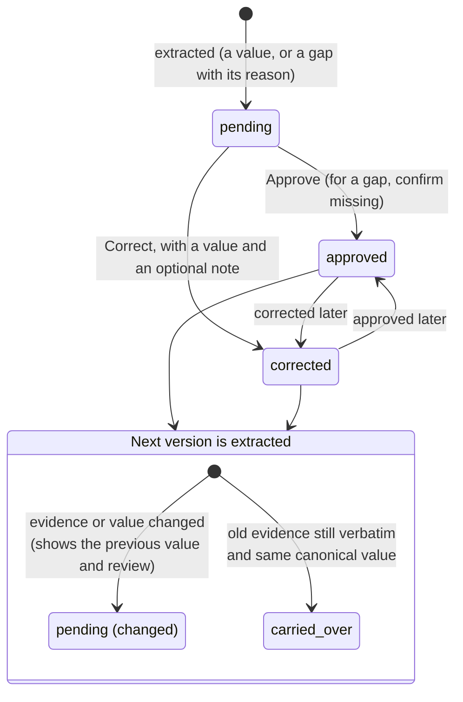

# Document extraction with human review

PDFs go in, an LLM extracts the fields for the document's type, and a reviewer approves or corrects every value against the exact passage it was quoted from. When a revised PDF arrives, reviews whose evidence did not change carry over; everything else goes back to the reviewer with the previous value beside it.

The brief is in [docs/ASSIGNMENT.md](docs/ASSIGNMENT.md); the working plan and its checklist are in [docs/PLAN.md](docs/PLAN.md).

## Run it

```sh
cp .env.example .env        # then set GEMINI_API_KEY in .env
docker compose up
```

| What | Where |
|---|---|
| Review UI | http://localhost:3000 |
| API | http://localhost:3001 |
| API docs (Swagger) | http://localhost:3001/docs |
| Postgres / Redis from the host | `localhost:5433` / `localhost:6380` |

`docker compose up` builds one image, runs the migrations, seeds version 1 of the three fixture documents, and starts the API, the worker and the UI. The worker picks the seeded documents up as soon as it starts; each extraction takes seconds when the model is available.

Without an API key everything still starts; extractions end as `failed` with a clear missing-key message. Add a key to `.env`, restart the worker (`docker compose restart worker`) and press **Retry**.

**Choosing the model** (in `.env`; see [.env.example](.env.example)):

| Variable | Meaning |
|---|---|
| `GEMINI_API_KEY` | Required for extraction. |
| `GEMINI_MODEL` | Gemini model, default `gemini-3.8-flash`. |
| `GEMINI_FALLBACK_MODEL` | Optional: tried when the Gemini model stays overloaded, e.g. `gemini-3.1-flash-lite`. |

**What to click first**

1. Open **Invoice — Meridian Office Supplies**. Values that need you are at the top; each sits beside its quote. **Show in document** highlights the quote in the parsed text.
2. Approve some values, correct one (with a note).
3. On the same page, upload `fixtures/documents/invoice-001.v2.pdf` as a new version. When it is extracted, exactly `due_date` and `total_amount` come back as **Needs review**, each showing what v1 said and how it was reviewed; the other three are **Carried over**, corrections included. The **Versions** links still open v1, read-only.
4. The market report shows `median_household_income` as a **gap** with the model's reason.

## Layout

```
apps/
  api/      NestJS HTTP layer: controllers, validation, error mapping, Swagger, PDF download
  worker/   Plain Node: BullMQ consumer, lease heartbeat, reconciler, PDF parsing,
            Gemini extractor, and a test-only rule extractor
  web/      Next.js review UI
packages/
  core/     Pure logic, no IO: field definitions, evidence matching, value
            canonicalization, extraction validation, carry-over rule, request contracts
  db/       Prisma schema and migrations, seed, and every state transition
            (upload, claim, heartbeat, commit, reconcile, review, retry) and read model
  queue/    Queue name and best-effort enqueue, shared by api and worker
```

Why these boundaries:

- **The rules that are easy to get wrong live in `core` and `db`, as plain functions.** `core` has no IO, so evidence matching and carry-over are unit-tested on the real fixture text. `db` functions take a `PrismaClient`, so the concurrency guarantees are tested against a real Postgres without booting Nest.
- **`api` and `worker` are thin.** Nest only parses requests and maps errors; the worker only drives the pipeline. Neither contains a rule the other needs.
- **The worker is a separate process without Nest.** It can be restarted, scaled or killed without touching the API, and it needs no dependency injection.
- **`queue` is its own package** so that neither `core` nor `db` depends on Redis.

Turborepo runs `build`, `lint`, `test` and `test:integration` across the workspace in dependency order; see [turbo.json](turbo.json).

## Schema

```
Document 1─* DocumentVersion 1─* ExtractedValue 1─* Review
                    │                   │
                    └─* ExtractionRun   └── baseline ──> ExtractedValue (same field, previous version)
```

- **`DocumentVersion`** is the unit of extraction. It holds the PDF, its **parsed text** (stored once, before the model is called), the status (`queued`, `extracting`, `extracted`, `failed`), the failure reason, an attempt counter and the worker's lease. Each version's values and evidence offsets refer to that version's own text, forever.
- **`ExtractedValue`** is one field of one version: the model's value (`null` for a gap), the verbatim evidence and its offsets, the gap reason, and a link to the same field in the previous version. `unique(versionId, field)` makes duplicate values impossible at the database level.
- **`Review`** is append-only. A value's state is derived from its latest review: none → `pending`, carried from an earlier review → `carried_over`, otherwise `approved` or `corrected`. There is no status column to keep in sync, and the history of every decision is kept.
- **Corrections are annotations.** The model's value is never overwritten; a `correct` review stores the reviewer's value beside it, and the API returns both `value` and `effectiveValue`. This keeps what the model said auditable and lets carry-over compare like with like.
- **`ExtractionRun`** stores the prompt, the raw response, any error and the token usage of every attempt, including which model answered when the fallback was used. The review page shows the latest run's model, tokens and duration.
- Nothing is deleted. Older versions, their values and their reviews stay readable (`GET /documents/:id?version=1`); only the latest extracted version accepts reviews.

## How extraction is coordinated

**Postgres is the system of record; Redis only carries "please extract version X".** Everything a user can see, and every state transition, is in Postgres. Losing Redis loses nothing but a few seconds.



A version's status:



1. **Upload.** One transaction stores the document and version as `queued`, then the API responds `202`. Enqueueing happens after, fire-and-forget, with Redis' offline queue disabled, so a Redis outage cannot slow an upload down.
2. **Claim.** A worker takes a version with one atomic `UPDATE … WHERE status = 'queued'` that sets `extracting`, a random lease token and `leaseExpiresAt = now() + 30s` (database clock). The same statement refuses a version while an earlier version of the same document is still queued or extracting.
3. **Work under a lease.** The worker heartbeats every 10s. Every write it makes (parsed text, failure, commit) is conditioned on its lease token, so a worker that was presumed dead and comes back cannot overwrite anything. A heartbeat that finds the lease gone aborts the in-flight model call.
4. **Commit.** One transaction locks the document row, checks the lease, inserts the values, applies carry-over and marks the version `extracted`. A second commit for the same version, from a retry, a recovered worker or a second worker, finds the lease gone and does nothing.
5. **Reconcile.** At startup, every 10 seconds and after each job, the worker repairs state from Postgres alone: expired leases go back to `queued` (or to `failed` after 3 lost workers), and every runnable `queued` version is enqueued again. BullMQ job ids are `v-<versionId>`, so re-enqueueing is harmless.

| What fails | What happens |
|---|---|
| Redis down during upload | Upload still answers at once; the reconciler enqueues the version when Redis is back. |
| `FLUSHALL` | Queued versions are re-enqueued within 10s; a version mid-extraction finishes, or its lease expires and it is retried. Values, reviews and failures are in Postgres. |
| Worker killed or `docker compose restart` mid-extraction | The lease expires after 30s; the version is requeued and extracted again. Parsed text is reused. |
| A worker keeps dying on one version | After 3 attempts it is `failed` with "The worker stopped responding 3 times…", and **Retry** requeues it. |
| The model is overloaded (429/503), unreachable, or hangs without answering | Retries with exponential backoff and jitter, honouring `Retry-After`, each call capped at 45s, all within a 150s budget; then the fallback model, if configured. If that is not enough, the version is `failed` with "temporarily overloaded … press Retry". |
| PDF unreadable, no text, model error, safety block, answer cut off (`MAX_TOKENS`), invalid JSON, timeout (3 min per attempt) | The version is `failed` with the reason; the run keeps the prompt and raw response. **Retry** requeues it. Permanent errors such as an invalid key are not retried. |
| Postgres down | Nothing can be accepted or committed; API calls fail, workers' leases expire, and everything resumes from Postgres' state when it is back. |

## Extraction and the hallucination defense

- The worker parses the PDF with `unpdf` and normalizes the text once (NFC, line endings, NUL bytes).
- It calls **Google Gemini** (see *Choosing the model*) with structured output: one `{value, evidence, missing_reason}` per expected field. The model sits behind a small `Extractor` interface, so the rest of the pipeline does not depend on the provider, and tests swap in a fake or a rule-based extractor. The prompt asks for a short verbatim passage containing the field's label and value, values in a fixed format (ISO dates, plain numbers), and `null` with a reason when a field is not stated. The document is passed as data, not instructions.
- **Every value must prove itself.** Its evidence has to occur verbatim in this version's parsed text, tolerating differences in whitespace only (PDF tables have runs of spaces, prose wraps mid-phrase) and respecting token boundaries (`Net 30` does not match inside `Net 300`). The value must also read as the field's type. Anything else is stored as a **gap** with a reason, for example *The quoted evidence does not appear in the document: "…"*. A gap is shown to the reviewer, never hidden.

## What "unchanged" means: review carry-over

For each field, the new version is compared with the same field in the latest earlier extracted version. A review carries over only when **both** hold:

1. **The old evidence still occurs, verbatim, in the new text.** This check uses the old passage, not whatever the model quotes this time, so it does not depend on the model picking the same span twice. It does not care where the passage moved or what was added around it.
2. **The new value equals the old value, or the reviewer's correction**, compared in canonical form (`$5,230.29` = `5230.29`, `March 1, 2025` = `2025-03-01`, strings case-insensitively). This catches a passage that survived while the document now states a different value elsewhere.

Otherwise the value is `pending` and shows the previous value and review. A reviewed gap carries over only if the whole text is unchanged.

A value's review state, derived from its latest review:



On the fixture invoice, v2 changes the title, payment terms, a line item, subtotal, tax and adds a paragraph that repeats the issue date. With this rule exactly `due_date` and `total_amount` return to review. The unit tests check this on the fixture text.

**Known limit:** if the model quoted an over-wide passage in v1 (several fields on one line), an unchanged field whose passage includes a changed neighbour goes back to review. That errs on the safe side: an extra review, never a wrong carry-over.

## Decisions the brief left open

| Question | Choice | Why |
|---|---|---|
| Correction replaces the value or sits beside it | Beside it, as an append-only review | Keeps what the model said; carry-over can compare model values across versions; full audit trail. |
| A new version while the previous is extracting | Queued, processed in order per document | Carry-over needs the previous version's final reviews. The previous version stays reviewable until the new one commits; a review that races the commit is either seen by carry-over or rejected with 409. |
| Store parsed text or re-parse | Store it per version, before calling the model | Evidence and offsets must refer to exactly the text the model saw, for that version, forever; retries reuse it. |
| Definition of "unchanged" | Old evidence still verbatim in the new text, and same canonical value | See above. |
| Polling, streaming or manual refresh | Poll every 800ms, only while a version is queued or extracting | Extraction takes a few seconds and there is one reviewer per document. Adaptive polling needs no extra infrastructure, feels instant, and stops completely when nothing is running. |
| Gaps | Reviewable: confirm missing, or correct with a value | A reviewer should be able to close every field. |
| Re-uploading an identical PDF | Creates a new version | Explicit is simpler; everything carries over. |
| Which LLM | Google Gemini with structured output, and a fallback Gemini model for overloads; model chosen in `.env` | The brief allows any provider with structured output. One provider keeps the surface small; the fallback model keeps extraction working when the primary is overloaded, which happened while building this. The model is an operational choice, so it lives in configuration, not in the UI. |

## Development

Two compose files: `docker-compose.yml` is the full stack as it ships; `docker-compose.dev.yml` runs only Postgres and Redis (separate project and volume), and the apps run on the host with instant reloads. They use the same ports, so run one or the other.

```sh
pnpm install
cp .env.example .env                     # set GEMINI_API_KEY; local URLs are already there
pnpm dev:up                              # Postgres + Redis, migrations, seed
pnpm dev                                 # api :3001, worker, web :3000 (next dev)

pnpm build
pnpm lint
pnpm test                                # unit tests, no services needed
pnpm test:integration                    # against Postgres on localhost:5433
pnpm test:e2e                            # Playwright, full stack; first: pnpm --filter @app/e2e exec playwright install chromium
```

- One package: `pnpm --filter @app/core test`. One test: `pnpm --filter @app/core exec vitest run -t "token boundaries"`.
- Integration and e2e tests create their own databases (`app_test`, `app_test_api`, `app_test_worker`, `app_e2e`) and never touch development data.
- `EXTRACTOR=rules` makes the worker extract the fixture fields with regular expressions instead of calling a model. It exists only so e2e tests and CI can run the whole pipeline without an API key; its quotes go through the same verbatim check.

**CI** ([.github/workflows/ci.yml](.github/workflows/ci.yml)) runs two jobs on every push: build, lint, unit, integration and e2e tests against Postgres and Redis service containers; and `docker compose up --build` followed by [scripts/smoke-test.sh](scripts/smoke-test.sh), which waits for the seeded documents to be extracted, runs `FLUSHALL` and a restart, checks nothing was lost, uploads invoice v2 and checks for duplicated values.

## Tests: what is most likely to break

- **Evidence and carry-over** (`packages/core`): verbatim matching with whitespace and token boundaries, the lease's wrapped line, canonical values, hallucinated evidence becoming a gap, and the invoice v1 → v2 matrix sending back exactly the two changed fields.
- **Coordination** (`packages/db`, real Postgres): a version committed twice, a stale worker fenced out of every write, recovery from an empty queue, a version failed after repeated worker loss and retried, a new version queued behind one still extracting, carry-over including a correction, and 409 on a stale review. Seeding is idempotent.
- **Worker** (`apps/worker`, real PDFs and Postgres, fake model): parsing the fixtures, a model error, a missing key, an unreadable PDF, a hung call hitting the deadline, and a worker losing its lease mid-call. The Gemini extractor is tested against a mocked HTTP API: retries through an overload spike, stopping when the time budget runs out, falling back on overload and on network errors, and never retrying a permanent error.
- **API** (`apps/api`, the real Nest app on Postgres with no Redis): uploads answer at once with Redis down, validation, 404/409, retry, and the Swagger document.
- **End to end** (`apps/e2e`, Playwright, the built apps): upload the invoice in the UI, correct one value and approve the rest, upload v2, and check that exactly the two changed fields come back with their previous values while the rest, the correction included, carry over; v1 stays read-only. Also: a missing field shows as a gap with its reason.

## Cut for time, and what I would do next

- **No authentication** and no notion of users; reviews are anonymous.
- **No live deployment.**
- **End-to-end tests use a rule-based extractor**, not the model: they prove the pipeline, the UI and carry-over, not extraction quality. Next: a small eval set of real documents with expected values, run against the model on demand.
- **PDFs are stored in Postgres** (`bytea`). Fine for page-long fixtures; object storage next.
- **No OCR**: a scanned PDF fails with "no extractable text".
- **Evidence trimming**: if over-wide quotes turn out to be common with real documents, trim each validated quote to the lines that contain the value, so unchanged fields carry over more often.

## At 10,000 documents

- **Storage**: move PDFs to object storage and keep only a key in Postgres; keep parsed text in Postgres (it is small and needed for evidence checks).
- **List and progress queries**: paginate `GET /documents`, and keep a per-version progress row updated in the review and commit transactions instead of aggregating reviews on every request. Add indexes for the "latest review per value" lookup if it shows up in query plans.
- **Reconciler**: today every worker scans for runnable versions every 10s. At scale, run it in one place (or take a Postgres advisory lock), scan by index only, and enqueue in batches.
- **Throughput and cost**: raise worker concurrency and add workers (claims are already safe across processes); use the Batch API for bulk backfills; cache the system prompt; pick the model per document type based on measured accuracy.
- **UI**: server-side search and filters ("documents with pending values"), and server-sent events instead of polling once many reviewers work at the same time.
